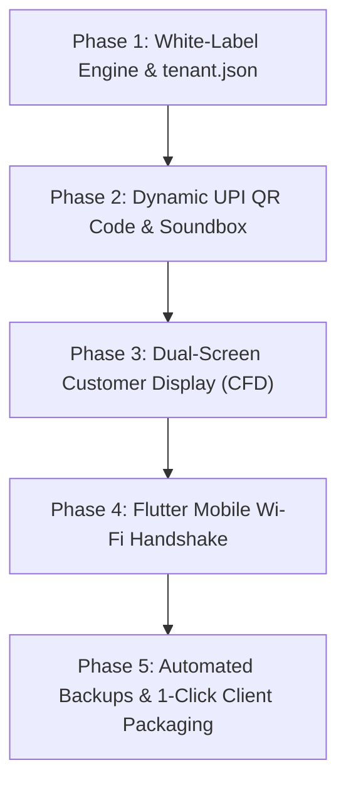

# 🛍️ Modern White-Label Offline Desktop POS
## Architectural Specification, Hardware Blueprint & Development Roadmap

---

## 📌 1. Executive Summary

The **Saraa Boutique / HyperPOS Desktop Application** is a high-performance, 100% offline-first native Windows desktop Point of Sale (POS) application built using **C# .NET 8 (WPF)** and an embedded **SQLite** database engine. 

This document consolidates the complete architectural strategy, hardware peripheral integrations, modern POS design features, disaster-recovery mechanisms, and white-labeling multi-tenant blueprint discussed for future expansion.

---

## 🏛️ 2. White-Label Multi-Tenant Architecture

Instead of maintaining separate repositories or branching codebases for different store clients, the application utilizes a **Config-Driven Single-Binary Architecture**. A single compiled `.exe` dynamically adapts its entire persona based on an adjacent configuration file.

### 2.1 Directory Structure Per Client Distribution

```
Client_Installation_Directory/
├── Saraa_Boutique_POS.exe       # Core agnostic .NET 8 POS Engine
├── tenant.json                  # Store branding, colors, currency, receipts
├── tenant.db                    # Isolated SQLite database (products, sales, shifts)
├── Launch_POS.bat               # 1-Click launcher with SmartScreen unblocker
└── assets/
    ├── logo.png                 # Brand logo displayed on header & receipts
    └── banner.png               # Promotional banner for CFD or lockscreen
```

### 2.2 `tenant.json` Configuration Schema

```json
{
  "tenant_id": "SARAA_001",
  "store_name": "Saraa Boutique",
  "tagline": "Exclusive Women's Wear & Designer Sarees",
  "logo_path": "assets/logo.png",
  "currency": {
    "symbol": "₹",
    "code": "INR",
    "display_format": "{symbol} {amount:N2}"
  },
  "theme": {
    "primary_color": "#289B37",
    "accent_color": "#3B4BD8",
    "header_bg": "#54587E",
    "surface_bg": "#FFFFFF",
    "card_bg": "#FAFAFA"
  },
  "database": {
    "file_name": "tenant.db",
    "enable_wal_mode": true
  },
  "receipt": {
    "header_line_1": "Saraa Boutique - 1st Cross, Gandhi Road",
    "header_line_2": "GSTIN: 33AAAAA0000A1Z5",
    "footer_message": "Thank you for shopping with us! Exchange within 7 days.",
    "printer_paper_width_mm": 80
  },
  "upi": {
    "merchant_vpa": "store@upi",
    "merchant_name": "Saraa Boutique"
  }
}
```

### 2.3 Dynamic Theming in WPF
* All visual elements in `MainWindow.xaml` and sub-windows reference dynamic resources (e.g. `Background="{DynamicResource PrimaryBrandBrush}"`).
* On startup, the application reads `tenant.json`, creates `SolidColorBrush` instances from the hex codes, and registers them into `Application.Current.Resources`.

---

## 🔌 3. Hardware Ecosystem & Retail Peripherals

Because the app is built with native C# WPF, it has direct access to Win32 APIs, USB HID, and COM ports with zero external drivers.

```
                    ┌──────────────────────────────────────────────┐
                    │      C# .NET 8 WPF Desktop POS Engine        │
                    └──────┬──────────────┬──────────────┬─────────┘
                           │              │              │
           ┌───────────────┴────┐   ┌─────┴──────┐  ┌────┴──────────────┐
           ▼                    ▼   ▼            ▼  ▼                   ▼
   [Barcode Scanners]     [Thermal Printers]   [Touchscreens]    [Payment Hardware]
   • USB Handheld         • 80mm / 58mm Rolls  • Single Touch    • Dynamic QR Display
   • 2.4GHz Wireless      • Auto Paper Cutter  • Multi-Touch     • Soundbox (Audio)
   • Bluetooth Long-range • RJ11 Cash Drawer   • Virtual Numpad  • Pine Labs/Plutus
   • Omni-directional     • ESC/POS Protocol   • Touch Steppers  • Customer Display
```

### 3.1 Barcode Scanners (USB HID Keyboard Wedge)
* **Supported Devices**: Zebra / Symbol LS2208, Honeywell Voyager, TVS BSC 101, Netum Wireless, Inateck Bluetooth.
* **Mechanism**: Operates as a high-speed virtual keyboard sending characters within 20ms followed by `VK_RETURN` (`Enter`).
* **Handling**: Global key listeners capture barcodes directly into the active cart without requiring manual cursor focus.

### 3.2 Thermal Receipt Printers & Cash Drawers
* **Standard Paper Sizes**: 80mm (48 columns) and 58mm (32 columns).
* **Communication**: Native Windows Print Spooler or direct raw `ESC/POS` commands.
* **Cash Drawer Pulse**: Sends command `\x1B\x70\x00\x19\xFA` via RJ11 through the printer to automatically pop open the cash drawer on tender completion.

### 3.3 Touchscreen Displays
* Windows native Touch API handles single-touch, swipe, and pinch gestures automatically.
* Touch targets are kept at a minimum of **40px–48px** height for accurate finger tapping.

---

## 🌟 4. Next-Generation POS Features

### 4.1 Dual-Screen Customer-Facing Display (CFD) Mode
* **Hardware**: Second monitor / 10-inch counter screen plugged into HDMI.
* **Implementation**:
  ```csharp
  if (Screen.AllScreens.Length > 1) {
      var cfd = new CustomerDisplayWindow();
      cfd.Left = Screen.AllScreens[1].Bounds.Left;
      cfd.Top = Screen.AllScreens[1].Bounds.Top;
      cfd.WindowState = WindowState.Maximized;
      cfd.Show();
  }
  ```
* **Customer Display Elements**:
  * Real-time itemized cart breakdown with product thumbnails.
  * Live total, discounts, and item count.
  * Dynamic, large UPI QR code for scanning.
  * Promotional slideshow when the register is idle.

### 4.2 Dynamic UPI QR Code & Payment Verification
* **Offline Generation**: Generates standard NPCI UPI links dynamically:
  `upi://pay?pa=store@upi&pn=StoreName&am=7442.00&tr=INV1002&cu=INR`
  Rendered using the embedded offline `QRCoder` library with zero internet dependency.
* **Auto-Verification Options**:
  * **Option A**: Integration with smart soundboxes (Paytm, PhonePe) or Pine Labs terminals via local LAN / Bluetooth API.
  * **Option B**: Polling payment gateway webhooks (Razorpay POS / Cashfree).
  * **Option C**: Free offline merchant VPA with manual 1-click confirmation by cashier.

### 4.3 WhatsApp / SMS E-Receipts
* Alongside physical 80mm thermal printing, cashier can click **"Send WhatsApp Bill"**.
* Triggers an automated pre-formatted invoice link sent directly to the customer's mobile number.

---

## 📱 5. Flutter Mobile Companion Integration

Connecting your existing Flutter mobile barcode scanner application creates an end-to-end store system:

```
┌─────────────────────────────────┐               ┌─────────────────────────────────┐
│     Flutter Mobile App          │   Local Wi-Fi │     C# Desktop POS              │
│  (Floor Staff / Warehouse)      │ ────────────> │  (Billing Counter Terminal)     │
│ • Camera Barcode Scanner        │   WebSocket   │ • hyperpos.db master database   │
│ • Floor Pre-Cart Creation       │   Port 8080   │ • Cash Drawer & Thermal Printer │
│ • Stock Inventory Audit         │               │ • Day-End Shift Settlement      │
└─────────────────────────────────┘               └─────────────────────────────────┘
```

1. **Wireless Handheld Scanner**: The phone camera scans saree tags on racks, transmitting scanned SKUs over local WebSocket to the desktop within 50ms.
2. **Floor Pre-Cart**: Sales staff build carts with customers on the showroom floor and click "Send to Counter". The cashier recalls the cart in 1 click.
3. **Emergency Offline Backup**: If laptop power dies, the Flutter app takes over billing independently.

---

## 🛡️ 6. Disaster Recovery, Power Cuts & Business Continuity

Retail stores cannot afford downtime during customer checkout rushes.

| Scenario | Risk | Built-in Protection |
| :--- | :--- | :--- |
| **Power Cut (Grid Outage)** | Computer turns off mid-sale | Laptops used instead of desktops provide 4–6h internal battery. Thermal printers powered by a mini 12V UPS. |
| **System Hardware Failure** | Laptop motherboard or SSD dies | **2-Minute USB Recovery**: The entire app is portable. Copy the folder to any other computer; double-click `Saraa_Boutique_POS.exe` and resume immediately with zero database installation. |
| **Emergency Mobile Billing** | Counter is inaccessible | Cashier switches to the Flutter mobile app to scan tags, collect cash/UPI, and sync transactions back when power resumes. |
| **Accidental Data Loss** | Database corruption or disk fault | Automated local database backup (`backups/hyperpos_YYYYMMDD_shift.db`) triggered on every Day-End Settlement. |

---

## ⚙️ 7. Technical Best Practices & Golden Rules

1. **Financial Arithmetic**: Always use `decimal` in C# and `NUMERIC` in SQLite. Never use `float` or `double` to prevent precision errors.
2. **SQLite WAL Mode**:
   ```sql
   PRAGMA journal_mode = WAL;
   PRAGMA busy_timeout = 5000;
   ```
   Prevents database locked errors during concurrent reads and writes.
3. **Zero Hardcoded Branding**: All strings, currency symbols, and color codes must be dynamic properties loaded from configuration.
4. **Git Hygiene**: Always use `.gitignore` to prevent large compiled binaries (`.exe`, `.zip`) and raw SQL dumps containing API secrets from being committed.

---

## 🗺️ 8. Phased Development Roadmap



* **Phase 1 (White-Label)**: Create `TenantConfig.cs`, convert hardcoded colors to `DynamicResource`, support dynamic currency (`₹`, `$`, `S$`).
* **Phase 2 (UPI & Payment)**: Implement on-screen dynamic UPI QR code generator (`QRCoder`) and payment confirmation flow.
* **Phase 3 (CFD)**: Design `CustomerDisplayWindow.xaml` and multi-monitor detection logic.
* **Phase 4 (Flutter Sync)**: Add local WebSocket listener on the desktop POS to receive camera scans from the Flutter mobile app.
* **Phase 5 (Packaging & Security)**: Create automated PowerShell build script to generate branded portable zip packages per client.
